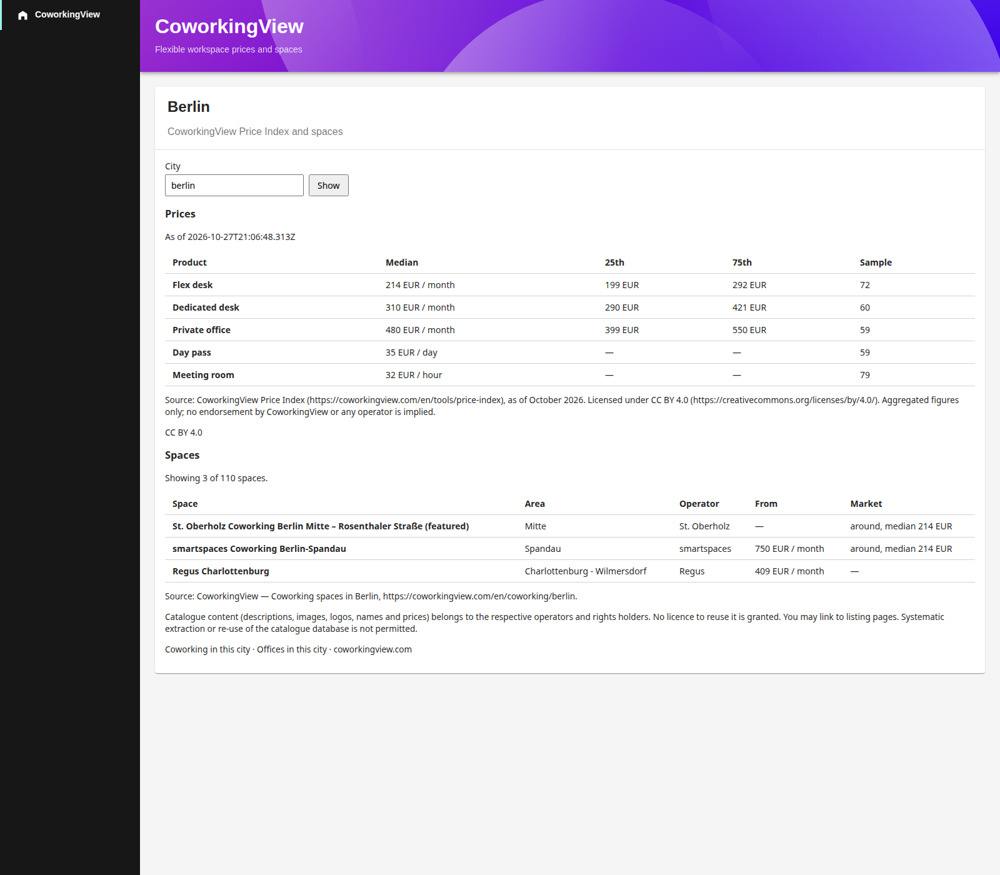

# CoworkingView for Backstage

Flexible workspace prices and spaces for teams planning an office or an offsite.
The plugin reads the public [CoworkingView](https://coworkingview.com) API
(`https://api.coworkingview.com`, no key): one city's Price Index medians, and
one page of spaces.



Code is Apache-2.0. Price Index figures are
[CC BY 4.0](https://creativecommons.org/licenses/by/4.0/).
The page prints the attribution string returned by the API. Credit the
CoworkingView Price Index and keep that notice visible.
Catalogue photos, logos and descriptions are not shown.

API reference: <https://coworkingview.com/en/api>

## Install

```bash
yarn --cwd packages/app add @coworkingview/backstage-plugin-coworkingview
```

```yaml
# app-config.yaml
coworkingview:
  defaultCity: berlin
```

`defaultCity` is the city slug requested on first load (`berlin`, `madrid`,
`abu-dhabi`). The city field on the card can change it later.

### New frontend system

Current Backstage apps discover the plugin from the package when `app.packages`
is `all`. The `/alpha` entry is a `createFrontendPlugin` with a page at
`/coworkingview`.

To install it in code instead:

```tsx
import coworkingViewPlugin from '@coworkingview/backstage-plugin-coworkingview/alpha';

const app = createApp({
  features: [coworkingViewPlugin],
});
```

`@backstage/frontend-plugin-api` is an optional peer. Apps on the new frontend
system already depend on it.

### Legacy frontend system

The package root is a `createPlugin` (`id: coworkingview`) for apps that still
use `createApp` from `@backstage/app-defaults`.

```tsx
import { CoworkingViewPage } from '@coworkingview/backstage-plugin-coworkingview';

<Route path="/coworkingview" element={<CoworkingViewPage />} />
```

Add a sidebar item in `Root.tsx` that points at `/coworkingview`.
`CoworkingViewCard` is the same prices-and-spaces card without the page header,
for a custom home page.

## Calls

| | |
|---|---|
| Prices | `GET /v1/market/rates?locale=en&city=` |
| Spaces | `GET /v1/properties?locale=en&city=&page=1&pageSize=10` |

Only those two calls, and only the city slug from config or the form.
`pageSize` stays at 10. Further pages are not requested.
Monthly medians come from `figures` (or `byType` when `figures` is empty).
Day pass and meeting room come from the `dayPass` and `meetingRoom` objects.
A sample under 10 is marked low sample. Amounts are shown as the API sent them.

Each space links to `https://coworkingview.com/en/workspace/{slug}`.
The card also links to the city pages on
[coworkingview.com](https://coworkingview.com).

## Browser access

On 1 Nov 2026 the API returned `access-control-allow-origin` for
`http://localhost:3000` and `https://coworkingview.com`, and not for other
origins. A Backstage app on another host needs the
[proxy](https://backstage.io/docs/plugins/call-existing-api/):

```yaml
proxy:
  endpoints:
    /coworkingview:
      target: https://api.coworkingview.com
      changeOrigin: true

coworkingview:
  defaultCity: berlin
  baseUrl: ${backend.baseUrl}/api/proxy/coworkingview
```

`baseUrl` is optional. When it is unset, the plugin calls
`https://api.coworkingview.com` directly and does not attach the Backstage
token. When it is set, requests go to that prefix and use `fetchApi`, which
the proxy needs.

No account, email or Backstage identity is sent to the public API.

## Development

```bash
cd integrations/backstage
npm ci
npm run tsc
npm run lint
npm test
npm run build
```

`npm start` opens the plugin in a Backstage dev app (`backstage-cli package start`).
Open `/coworkingview?fixtures=1` to render the checked-in API fixtures instead
of the network. The screenshot above is that page.

Tests use `@backstage/test-utils` and `src/fixtures/`. They do not call the network.
The fixtures are the shared responses in `spec/fixtures/`, with operator prose
and images already replaced by placeholders.
