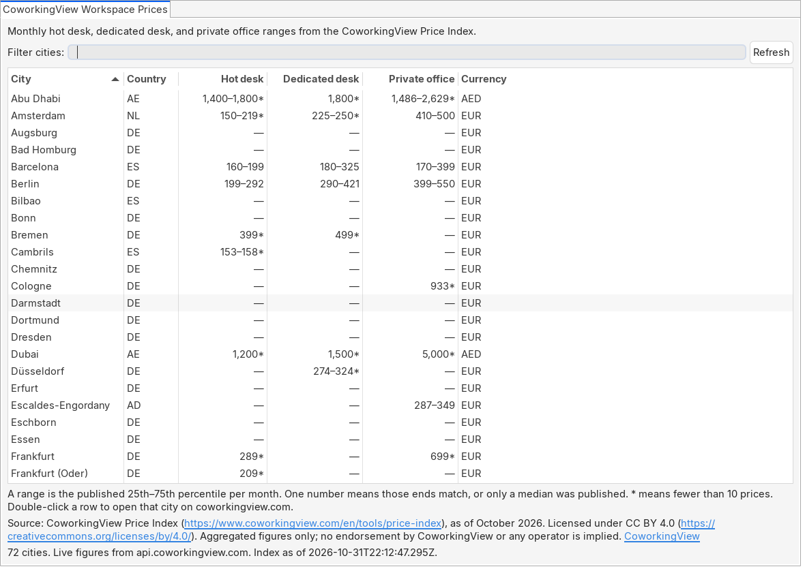
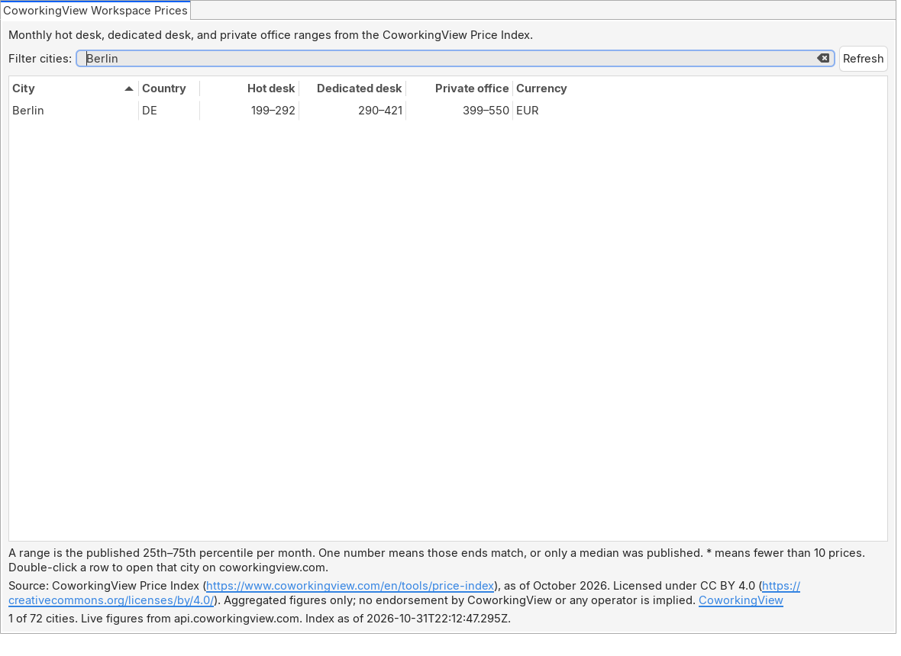

# CoworkingView Workspace Prices

Eclipse view of flexible-workspace price ranges from the [CoworkingView Price Index](https://coworkingview.com/en/tools/price-index).

Open it from **Window → Show View → Other… → CoworkingView → CoworkingView Workspace Prices**. The table lists published cities. Where the index has them, the columns are the monthly range for a hot desk (`flex_desk`), a dedicated desk (`fix_desk`), and a private office. A range is the published 25th–75th percentile. One number means those two ends are the same, or the index published a median and no spread. An asterisk means the sample is under 10 prices. A dash means that product is not published for the city.

**Refresh** (on the view toolbar, the view menu, and the button in the view) requests `GET https://api.coworkingview.com/v1/market/rates` over HTTPS. The locale is `de` or `es` when Eclipse is running in that language, and `en` otherwise. If the request fails, the view keeps showing the last good table when it has one, and otherwise shows the snapshot bundled in the plug-in (captured 2026-11-01, English names). The status line says which of the two you are looking at.

The line under the table is the attribution string from the response, with links only for CoworkingView and Creative Commons. It always ends with a link to [https://coworkingview.com](https://coworkingview.com). Double-click a row, or use the context menu, to open that city at `https://coworkingview.com/en/coworking/{slug}`.

No account, no API key, no telemetry. The plug-in does not phone home at startup. It does not follow HTTP redirects. The only optional setting is the environment variable `COWORKINGVIEW_API_URL`, the same origin override the other clients in this repository use. It must be `https`, or `http` on `127.0.0.1` / `localhost` for a test server. CoworkingView built this plug-in with AI assistance.

Maintained by [CoworkingView](https://coworkingview.com). The API is described at [https://coworkingview.com/en/api](https://coworkingview.com/en/api).

## Install

Eclipse 2024-12 (4.34) or newer. Those packages run on Java 21. The plug-in bytecode is Java 17.

The update site is published when a tag `eclipse-v*` is built. The planned URL is:

`https://coworkingview.github.io/flex-office-data/eclipse/updates/`

This repository had no GitHub Pages site when the plug-in was added. The tag workflow publishes that path and does not replace other Pages content. Until the first tag has been built, install from a p2 repository you built locally (see below).

1. **Help → Install New Software…**
2. **Add…** Name: `CoworkingView`. Location: the update site URL above.
3. Choose the category **CoworkingView** and the feature **CoworkingView Workspace Prices**.
4. Finish the wizard and restart if Eclipse asks.

The feature id is `com.coworkingview.eclipse.feature`. The provider is CoworkingView.

If GitHub Pages is not available, the same tag attaches `coworkingview-eclipse-p2.zip` to the GitHub Release. Add this location instead (the `eclipse-v0.1.0` segment matches the tag):

```text
jar:https://github.com/coworkingview/flex-office-data/releases/download/eclipse-v0.1.0/coworkingview-eclipse-p2.zip!/
```

### Drag to install

Eclipse Marketplace shows this button after the listing exists. `NODE_ID` is the id Marketplace assigns. It is not known until the listing is created. The image and the query parameter are the ones Marketplace currently gives out (checked on the Marketplace Client listing, 1 November 2026).

```html
<a href="https://marketplace.eclipse.org/marketplace-client-intro?mpc_install=NODE_ID" class="drag" title="Drag to your running Eclipse* workspace. *Requires Eclipse Marketplace Client">

</a>
```

Drag that image onto a running Eclipse that has the Marketplace Client. Field values for the listing form are in [MARKETPLACE-LISTING.md](MARKETPLACE-LISTING.md).

## Privacy

Refresh sends one HTTPS GET to `api.coworkingview.com`. The query is `locale=en`, `locale=de`, or `locale=es`. No city, no workspace path, and no Eclipse account is sent. The plug-in stores nothing. It sets no cookie. It does not include a usage reporter. `User-Agent` is `coworkingview-eclipse/0.1.0 (+https://github.com/coworkingview/flex-office-data)`.

A 429 or 5xx is retried once. The wait is `Retry-After`, otherwise `RateLimit-Reset`, otherwise 2 seconds, and never more than 10. Other errors are not retried. The view then explains the failure and, on the first load, shows the bundled snapshot.

The website policy at [https://coworkingview.com/en/privacy](https://coworkingview.com/en/privacy) describes the website. It is not a description of this plug-in.

## What is bundled

`resources/snapshot.json` is `GET /v1/market/rates?locale=en` saved on 2026-11-01. `buildings` arrays were removed so the plug-in does not ship catalogue listings. The attribution text is unchanged. `resources/snapshot.properties` records the capture day.

## Screenshots

The pictures in `docs/screenshots/` are the plug-in's view composite, drawn by SWT under Xvfb (`tools/screenshot.sh`). A `CTabFolder` supplies the view tab. The Eclipse menu bar and the workbench trim are not in the frame. The prices are whatever `RatesClient` loaded when the script ran: the live index when the API answered, otherwise the bundled snapshot. The status line in the image says which.





## Build

The build needs JDK 21 and Maven 3.9 or newer (Tycho 5.0.4). The plug-in is compiled for Java 17. The target is the Eclipse 2026-09 platform.

```console
mvn -B verify
```

That builds the plug-in, runs the tests, and writes the p2 repository to `com.coworkingview.eclipse.site/target/repository`. Tests use `spec/fixtures/market_rates.json` and a loopback HTTP server. They do not call the public API. The default test run does not open a display.

Screenshots:

```console
./tools/screenshot.sh
```

Icons are `tools/render_icons.py` (serif “CV”, gold dot, off-white). Regenerate them with Pillow if you change the script.

GitHub Actions workflow [`.github/workflows/eclipse.yml`](../../.github/workflows/eclipse.yml) runs `mvn -B verify` on pull requests. A tag `eclipse-v*` publishes the repository to GitHub Pages at `/eclipse/updates/` and uploads the zip to the GitHub Release.

## Licence

Plug-in code is MIT. See [LICENSE](LICENSE).

Price Index data is not MIT. It is [CC BY 4.0](https://creativecommons.org/licenses/by/4.0/). Keep the attribution line with any figure you republish. The catalogue (names, photos, descriptions) is not included.
