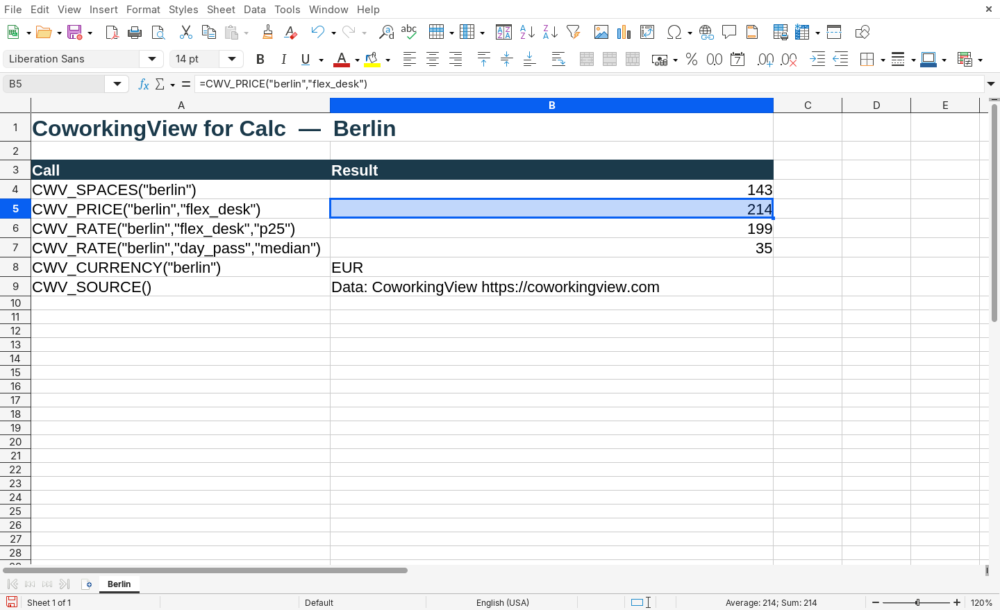
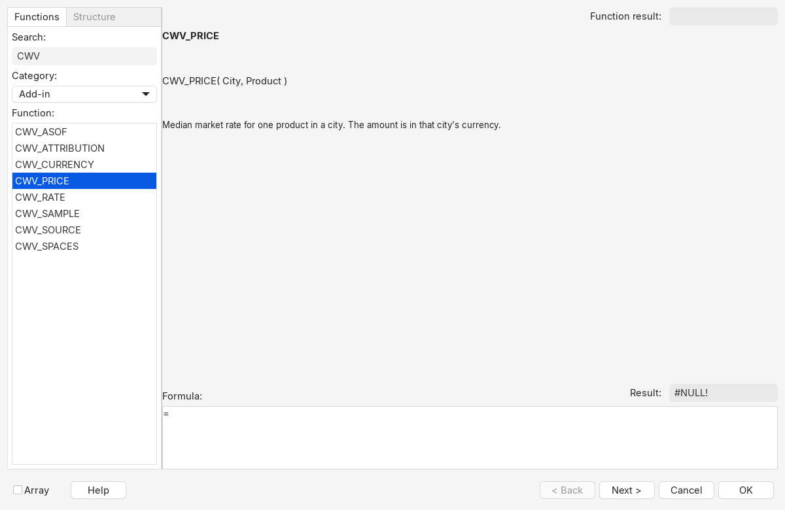
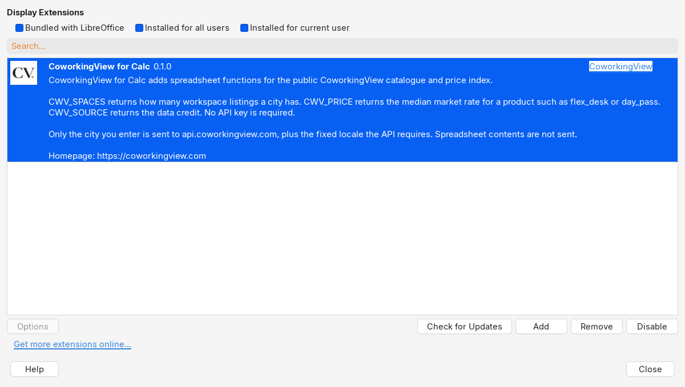

# extensions.libreoffice.org listing

Paste this into the English entry. Create the English entry first and save it before uploading the `.oxt`. Tags are translated by the site moderators; do not add translated tag lists.

Sources for the field shape: [Using this site as an extension maintainer](https://extensions.libreoffice.org/en/home/using-this-site-as-an-extension-maintainer), the release tables on the three listings below, and the 2024 extension book cited in [PUBLISHING-CHECKLIST.md](PUBLISHING-CHECKLIST.md).

## Listings used as the model

1. [Lox365: Modern functions for LibreOffice](https://extensions.libreoffice.org/en/extensions/show/27434) (latest release on the page: 2024-10-16). Calc functions. Tags shown: Business, Calc, Extensions, Spreadsheets. The description ends with a `Homepage:` line. The release table has Release, Description, Compatibility, Operating Systems, License, Release notes, Updated, Download. Compatibility values include `7.0` and `24.2`. Operating systems are Linux, Windows, macOS.
2. [Pandas for LibreOffice](https://extensions.libreoffice.org/en/extensions/show/41998) (latest release on the page: 2025-01-08). English description with `Homepage:` and `Repository:` lines. Release rows use compatibility `7.0`, operating systems Linux, Windows, macOS, and license `MIT`.
3. [LibrePythonista](https://extensions.libreoffice.org/en/extensions/show/99231) (latest release on the page: 2025-08-05). Calc extension. Release rows use compatibility `7.0` and operating systems Linux, Windows, macOS.

[Office 2003 Blue Theme](https://extensions.libreoffice.org/en/extensions/show/99300) (releases through 2025-06-22) is the check that `MIT` is still a license value on the current form, including a row whose compatibility is `25.8`.

## Entry

| Field | Value |
|---|---|
| Language | English, saved first. This is the fallback for every other language. |
| Title | CoworkingView for Calc |
| Tags | Calc, Spreadsheets, Extensions, Business |
| Category | Calc, if the form still has a separate single-select category. Do not also select Writer, Impress, Draw or Base. |
| Homepage URL | https://coworkingview.com |
| Source repository | https://github.com/coworkingview/flex-office-data |
| Documentation | https://github.com/coworkingview/flex-office-data/tree/main/integrations/libreoffice |
| Contact, if the form asks | mailto:info@coworkingview.com |
| Project logo | Upload [logo-150.png](logo-150.png) (150×150, the CoworkingView wordmark). Link the logo to https://coworkingview.com. |
| Logo link | https://coworkingview.com |

### Short description

CoworkingView workspace counts and price-index rates as Calc functions. No API key. Homepage: https://coworkingview.com

(119 characters. The old Plone summary limit called out in the publishing PDF was 200.)

### Long description

CoworkingView for Calc adds spreadsheet functions for the public CoworkingView catalogue and price index. No account and no API key.

CWV_SPACES(city) is the number of workspace listings in a city. CWV_PRICE(city, product) is the median market rate for a product such as flex_desk, fix_desk, private_office, day_pass or meeting_room. CWV_RATE reads median, min, max, p25 or p75 when that statistic is published. CWV_CURRENCY, CWV_SAMPLE and CWV_ASOF are the currency, the sample size and the price-index timestamp. CWV_SOURCE() returns the data credit. CWV_ATTRIBUTION(city) returns the attribution text that ships with the price index.

Figures come from https://api.coworkingview.com. Only the city you type is sent, plus a fixed locale of en (the API rejects a request without it). Spreadsheet contents are not sent. An empty city means Berlin.

Install the .oxt from this page, accept the MIT license, and restart LibreOffice. The functions are in the Function Wizard under Add-In. LibreOffice 7.0 and newer, including 24.x, on Linux, Windows and macOS.

The price index is CC BY 4.0. Keep CWV_ATTRIBUTION with any figure you republish. This extension does not copy workspace descriptions, photos or logos.

Homepage: https://coworkingview.com

Repository: https://github.com/coworkingview/flex-office-data

## Release 0.1.0

Save the entry, then add one release. Upload the file. Do not make the Download button a link to somewhere else: a review on the Lox365 page asked why the file was not on the extensions site.

| Field | Value |
|---|---|
| Release | 0.1.0 |
| Description | Initial release of CoworkingView for Calc. |
| Compatibility | 7.0 |
| Operating systems | Linux, Windows, macOS |
| License | MIT |
| File | `release/coworkingview-calc-0.1.0.oxt` (the zip from `./build.sh`) |

Release notes:

```
Initial release for LibreOffice 7.0 and newer, including 24.x, on Linux, Windows and macOS.

Functions: CWV_SPACES, CWV_PRICE, CWV_RATE, CWV_CURRENCY, CWV_SAMPLE, CWV_ASOF, CWV_SOURCE, CWV_ATTRIBUTION.

CWV_PRICE is the published median from the CoworkingView Price Index. CWV_SPACES is the number of workspace listings, not the price-index sample. The extension does not copy the catalogue. MIT licence. The price index is CC BY 4.0.
```

After **Publish**, a moderator handles the request. That is the current site, not the old "submit for approval before you can upload" flow.

## Screenshots to upload

Captured from LibreOffice 24.2.7 on an English (USA) locale. Each PNG is at least 1024 pixels wide. Upload these three files with the English entry. The maintainer guide says screenshots are optional and help the extension show up in search.

| File | What it shows |
|---|---|
| [screenshots/sheet-berlin.png](screenshots/sheet-berlin.png) | Calc sheet. `CWV_SPACES("berlin")` is 143, `CWV_PRICE("berlin","flex_desk")` is 214, `CWV_RATE("berlin","flex_desk","p25")` is 199, `CWV_RATE("berlin","day_pass","median")` is 35. The formula bar shows the comma separators English (USA) uses. |
| [screenshots/function-wizard.png](screenshots/function-wizard.png) | Function Wizard, category **Add-in**, `CWV_PRICE` selected. The signature is `CWV_PRICE(City, Product)` and the description is the median market rate. The other `CWV_` functions are in the list. |
| [screenshots/extension-manager.png](screenshots/extension-manager.png) | Extension Manager entry **CoworkingView for Calc 0.1.0**, the wordmark icon, the publisher link **CoworkingView**, and the description ending with `Homepage: https://coworkingview.com`. |







English (USA) check, same session: typing `=CWV_PRICE("berlin","flex_desk")` with commas returned **214**. `=CWV_SPACES("berlin")` returned **143**. `=CWV_RATE("berlin","flex_desk","p25")` returned **199**. `=CWV_RATE("berlin","day_pass","median")` returned **35**. `=CWV_CURRENCY("berlin")` returned **EUR**. `=CWV_SOURCE()` returned `Data: CoworkingView https://coworkingview.com`. The status bar read English (USA).

## What not to put on the page

- Do not claim the extension works on a LibreOffice older than 7.0. The package dependency is `LibreOffice-minimal-version` 7.0, and there is no maximum.
- Do not describe city-level entry prices, building names, or catalogue photos as function results. Those fields exist and are not returned.
- Do not replace the wordmark with a red square, and do not point the publisher or the homepage at `www.coworkingview.com`.
