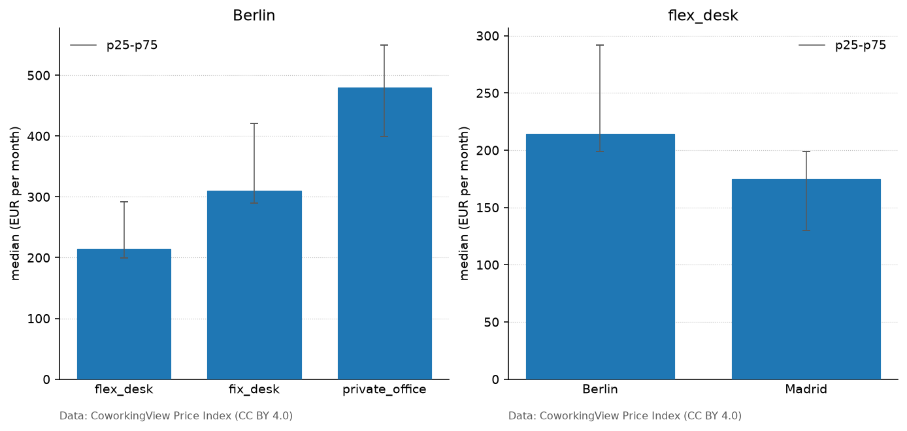

# mpl-coworkingview

Matplotlib bar charts of the public [CoworkingView](https://coworkingview.com) Price Index.

`plot_city_rates` and `plot_rate_comparison` call `GET /v1/market/rates` on `https://api.coworkingview.com` and draw one bar per median. The height is `median.amount`. When the response includes `p25` and `p75`, those amounts are the interval around the bar. A row with `sample_size` below 10 is hatched (`low_confidence`).

The API is public. There is no API key. The Price Index is open data under [CC BY 4.0](https://creativecommons.org/licenses/by/4.0/). Every chart sets the x-axis label to:

`Data: CoworkingView Price Index (CC BY 4.0)`

Keep that line with anything you publish. This package does not search the workspace catalogue.

**Homepage:** https://coworkingview.com

**Documentation:** https://github.com/coworkingview/flex-office-data/tree/main/integrations/matplotlib#readme

**Source:** https://github.com/coworkingview/flex-office-data

## Install

Python 3.9 or newer, and Matplotlib 3.8 or newer.

```bash
pip install mpl-coworkingview
```

From a checkout of this repository:

```bash
pip install ./integrations/matplotlib
```

The HTTP client is `urllib` from the standard library. The only dependency is Matplotlib.

## Example



The figure above is `docs/example.png`. It is drawn from `spec/fixtures/market_rates.json` (a recorded `GET /v1/market/rates?locale=en` response, `asOf` `2026-10-27T21:06:48.313Z`) by `tools/render_example.py`. Regenerating it does not use the network.

```python
import matplotlib.pyplot as plt
import mpl_coworkingview as cv

fig, ax = plt.subplots()
cv.plot_city_rates(ax, "berlin", currency="EUR")
fig.savefig("berlin-rates.png", bbox_inches="tight")
```

`city` is the city slug (`berlin`, `madrid`, `abu-dhabi`), sent as the `city` query parameter. `locale` defaults to `en` (`es` and `de` are the other values the API accepts; a request without `locale` is rejected). `currency` is optional: `EUR`, `GBP`, `USD`, `CHF`, `AED`, or `VES`. Omit it to keep the city's own currency. `products` limits the bars to those `optionType` values. The default is the monthly products (`unit` `month`): `flex_desk`, `fix_desk`, `private_office`, and any other monthly figure the API adds.

`day_pass` is a daily median and `meeting_room` is an hourly median. They are not drawn next to monthly bars. Pass `products="day_pass"` to plot that row on its own.

```python
fig, ax = plt.subplots()
cv.plot_rate_comparison(ax, ["berlin", "madrid"], product="flex_desk")
```

`plot_rate_comparison` sends one request without `city` (that parameter is a single slug) and keeps the cities in the order you passed. Tick labels are `city.name`. Every bar has to share one `currency` and one `unit`. If the cities come back in different currencies, pass `currency` so the API converts them. `product` defaults to `flex_desk`.

`country`, when passed, is the `country` query parameter, unchanged. On 2026-11-03 the API accepted values matching `^[a-z0-9-]+$` and rejected `DE`.

An unpublished city, or a slug with no published rates, raises `CoworkingViewError`. HTTP 429 and 5xx are retried once. The wait is the `Retry-After` header, else `RateLimit-Reset`, else 2 seconds, and never more than 10 seconds. Any other error raises `APIError` with `status`, `code`, `title` and `detail` from the problem body. The client sends `User-Agent: mpl-coworkingview/0.1.0 (+https://github.com/coworkingview/flex-office-data)`.

`COWORKINGVIEW_API_URL` replaces the API root. Nothing is fetched at import time.

## Develop

CI for this package is the `mpl-coworkingview` job in `.github/workflows/ci.yml`.

From `integrations/matplotlib`, with the repository checkout so the tests can read `spec/fixtures`:

```bash
pip install -e ".[dev]"
python -m ruff check . && python -m ruff format --check .
python -m pytest
python tools/render_example.py
```

`COWORKINGVIEW_LIVE_TESTS=1` enables one live request (`plot_city_rates` for Berlin). The default test run uses the fixtures only.

## License

The package is MIT. The Price Index figures it plots are CC BY 4.0. See `LICENSE`.
